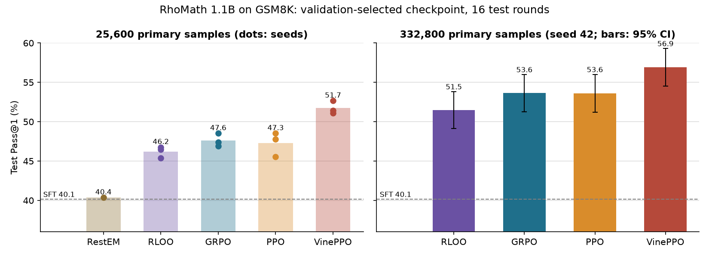
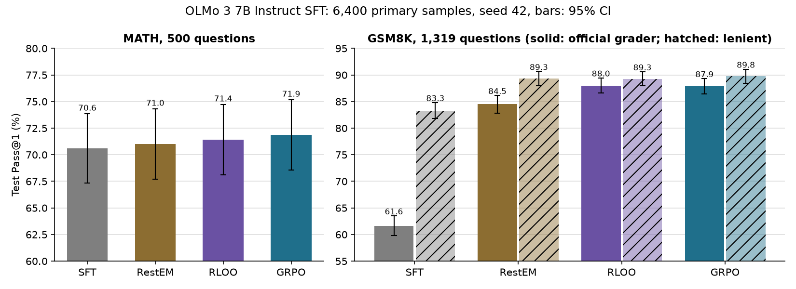
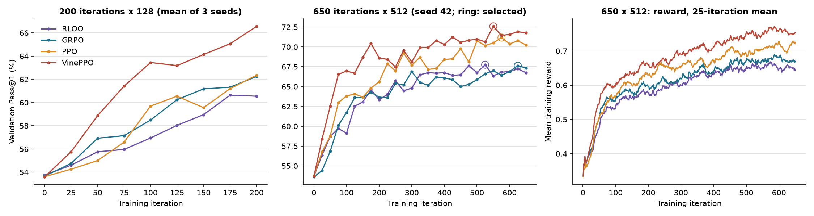
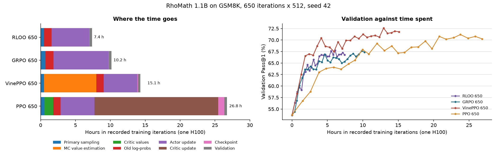

# Results summary: VinePPO reproduction, baselines and OLMo 3

20261124-174645 EST · `3c367b2`

Responds to Tom's request of 2026-11-24 to summarize the current results, plots and implementation choices. It consolidates the [detailed report](20261122-110919_final-report-detailed.md), the [OLMo baselines report](20261124-151031_olmo-baselines-and-bucket.md) and the [answer-format note](20261124-080354_olmo-gsm8k-format-vs-accuracy.md), which hold the per-run tables and W&B links. The figures are new. The numbers come from those reports' tables, except the validation-against-time readings under Figure 4, which I read from the run metrics.

## Main findings

1. **VinePPO is the best arm on RhoMath GSM8K at both budgets.** At 25,600 training samples it scores 51.73% test Pass@1 against 47.60% for GRPO, 47.30% for PPO and 46.21% for RLOO (three seeds each). At the paper's 332,800 samples it scores 56.90% against 53.63%, 53.62% and 51.48% (one seed).
2. **The gap to PPO matches the paper; the gap to GRPO and RLOO is much smaller.** At the paper's budget VinePPO beats PPO by 3.28 points (paper: 3.3) and GRPO by 3.27 (paper: 8.8). Our GRPO and RLOO score 9.0 and 7.0 points above the paper's.
3. **Per GPU-hour the evidence is mixed.** At 128 samples per iteration, GRPO run for 500 iterations (KL 1e-4) ties VinePPO at 200 (51.74% against 51.73%) in about 1.9 against 1.5 GPU-hours. At 512 samples per iteration, VinePPO's best validation score so far is ahead of every other arm's from about 2 hours on.
4. **RestEM at the matched sample budget does not improve RhoMath:** 40.37% against 40.15% for SFT.
5. **OLMo 3 gains little on MATH and mostly answer format on GSM8K.** MATH: GRPO +1.27 points over SFT, the only gain whose interval excludes zero. GSM8K: +23 to +26 points by the official grader, +6.0 to +6.5 once answer format is set aside.
6. **Cost.** Moving sampling to vLLM cut a VinePPO iteration from 2,034 s to 39 s. In the long runs, MC value estimation is half of VinePPO's time and the critic update is two thirds of PPO's.

VinePPO and PPO on OLMo are not done. See [In progress](#in-progress-and-not-done).

## Reading the numbers

- **Pass@1:** one sampled answer per test question at temperature 0.35, averaged over 16 rounds. GSM8K has 1,319 test questions and MATH has 500.
- **Checkpoint:** the one with the highest four-round validation Pass@1 (373 GSM8K or 500 MATH questions), earliest on a tie. It is tested once.
- **Intervals:** 95%, clustered by question. Differences between arms are paired on the same questions and given in points.
- **Primary samples:** the responses the policy is trained on. **MC tokens:** the extra rollouts VinePPO samples to estimate values.
- **Seeds:** the 200-iteration RhoMath arms have three training seeds. Everything else has one.

## RhoMath 1.1B on GSM8K

*Figure 1. Left: bars are seed means and dots are seeds; RestEM has one seed. Right: one seed, bars are 95% intervals. The dashed line is SFT.*

### 25,600 primary samples (200 iterations × 128)

| Arm | Test Pass@1, mean ± SD over seeds | Seeds 42, 43, 44 | Sampled tokens per run | GPU wall per run |
|---|---|---|---|---|
| SFT | 40.15% [38.05, 42.26] | | | |
| RestEM, matched | 40.37% [38.22, 42.53] | seed 42 only | 2.63M | 0:58 |
| RLOO | 46.21 ± 0.72% | 46.46, 46.77, 45.40 | 2.57–2.63M | 0:46–0:50 |
| GRPO | 47.60 ± 0.85% | 47.37, 48.53, 46.89 | 2.69–2.71M | 0:51–0:54 |
| PPO | 47.30 ± 1.54% | 45.57, 48.53, 47.80 | 2.54M to ≥2.74M | 2:29–2:44 |
| VinePPO | 51.73 ± 0.83% | 51.11, 51.40, 52.67 | 2.75–2.82M primary, 49.0–56.0M MC | 1:29–1:35 |

- **VinePPO wins every same-seed comparison.** Mean paired gaps: +4.13 over GRPO, +4.43 over PPO, +5.52 over RLOO.
- **Three seeds leave the size uncertain.** The t interval over seeds for the GRPO gap is +0.42 to +7.84.
- **RestEM:** +0.22 points over SFT [−0.53, +0.97]. Validation fell from 51.61% after round 1 to 45.24% after round 10, always below the 53.62% SFT validation score.

### 332,800 primary samples (650 iterations × 512, the paper's budget, seed 42)

| Arm | Selected iteration | Validation | Test Pass@1 [95% CI] | Paper, Figure 4 | Sampled tokens | GPU wall |
|---|---|---|---|---|---|---|
| SFT | | 53.62–53.75% | 40.15% [38.05, 42.26] | 40.3% | | |
| RLOO | 525 | 67.76% | 51.48% [49.14, 53.82] | 44.5% | 34.9M | 7:37 |
| GRPO | 625 | 67.63% | 53.63% [51.26, 55.99] | 44.6% | 40.7M | 10:34 |
| PPO | 575 | 71.18% | 53.62% [51.23, 56.00] | 50.1% | 36.9M | 27:20 |
| VinePPO | 550 | 72.59% | 56.90% [54.50, 59.30] | 53.4% | ≥38.7M primary, ≥629.4M MC | 15:37 |

- **Paired gaps from VinePPO:** +3.27 over GRPO [+1.60, +4.94], +3.28 over PPO [+1.54, +5.03], +5.42 over RLOO [+3.69, +7.16].
- **Every arm scores above the paper's figure:** PPO and VinePPO by 3.5 points, RLOO by 7.0, GRPO by 9.0. Our protocol differs in ways listed under [Implementation choices](#implementation-choices), and the GRPO and RLOO losses are our own, so this is not a like-for-like replication.
- **PPO's validation lead over GRPO does not carry to test.** PPO is 3.6 points ahead on validation and level on test.
- **The paper also reports** 42.8% for RestEM, which we ran only at the smaller budget.

### Ablations (200 iterations, three seeds)

| Question | Arms | Test Pass@1 | Paired difference, t interval over seeds |
|---|---|---|---|
| Does sampling each distinct MC prefix once change accuracy? | VinePPO with dedup against without | 51.73% against 49.61% | +2.12 [−2.46, +6.70] |
| Does the KL coefficient matter for GRPO? | 3e-3 against 1e-4 | 47.60% against 47.12% | +0.48 [−4.81, +5.76] |
| Does GRPO catch up with more iterations? | VinePPO 200 against GRPO 500 (KL 1e-4) | 51.73% against 51.74% | −0.01 [−2.07, +2.05] |

- **Dedup saves work:** 29% fewer MC requests (67,269–68,661 against 95,231–97,278 per run) and 49.0–56.0M against 72.8–77.6M MC tokens. The accuracy difference is not distinguishable from zero, and the code also changed between the two sets of runs.
- **GRPO 500** used 64,000 primary samples and 7.4–7.7M tokens in 1:53–1:59.

## OLMo 3 7B Instruct SFT

*Figure 2. 50 iterations × 128 samples (RestEM: 10 rounds × 640), seed 42, H200. GSM8K shows the official grader (solid) and the lenient reading (hatched).*

| Arm | MATH, test | MATH, gain over SFT | GSM8K, official grader | GSM8K, lenient | GSM8K lenient gain over SFT |
|---|---|---|---|---|---|
| SFT | 70.59% | | 61.65% | 83.29% | |
| RestEM, matched | 71.00% | +0.41 [−0.31, +1.14] | 84.49% | 89.31% | +6.01 [+5.00, +7.02] |
| RLOO | 71.41% | +0.83 [−0.04, +1.69] | 88.01% | 89.26% | +5.97 [+4.99, +6.95] |
| GRPO | 71.86% | +1.27 [+0.38, +2.17] | 87.87% | 89.77% | +6.48 [+5.39, +7.56] |

- **Lenient reading:** the last number in the response equals the reference, ignoring `$`, separators and trailing zeros. It is my definition, not the paper's, and it can credit a right number reached by accident.
- **Why two readings:** the SFT model often writes its answer in `\boxed{}` or as `#### $70,000`, which the official grader marks wrong. 82.07% of SFT responses have a `####` answer, against 99.46–99.70% after training.
- **The three trained arms are indistinguishable on the lenient reading.** RestEM trails by 3.4–3.5 points on the official grader because more of its right answers are in the wrong format (1,017 responses against 400 and 265).
- **Grader ceiling:** 14 test references contain a thousands separator that the official grader can never match, so official-grader Pass@1 cannot exceed 98.94%.
- **Cost:** MATH runs sampled 2.73–2.81M tokens in 3:04–5:14. GSM8K runs sampled 0.87–1.02M tokens in 1:27–4:18. RestEM is the slowest in both.

## Training health

*Figure 3. Left: validation Pass@1, mean of three seeds. Middle: the long runs; rings mark the selected checkpoint. Right: mean training reward in the long runs, smoothed over 25 iterations.*

- **Every RL arm improves on validation.** In the long runs GRPO and RLOO level off near 67% from about iteration 300. PPO and VinePPO reach their best at iterations 575 and 550.
- **Reward over the last 25 iterations of the long runs:** VinePPO 0.753, PPO 0.721, GRPO 0.668, RLOO 0.644.
- **RLOO looks untuned.** 29–35% of its sequences hit the ratio clip on RhoMath and 40–49% on OLMo. On RhoMath its gradient norm before clipping is 15–17 against a limit of 1.0. The other arms clip under 1% of tokens. Its scores are probably a lower bound for the method (inference).
- **Resumes are continuous.** The long GRPO, VinePPO and PPO runs each span two to four allocations. Reward, KL and learning rate are continuous across every boundary that has adjacent metric rows.
- **Validation runs far above test on GSM8K.** SFT scores 53.6% on validation and 40.15% on test. OLMo shows the same direction (68.57% against 61.65%), so the validation split is probably easier in itself (inference). I have not established why.

## Cost

*Figure 4. The long RhoMath runs. Hours sum the logged iteration times: sampling, updates, checkpoints and validation, without job startup or the final test.*

- **By phase:** MC value estimation is 49.8% of VinePPO's time. The critic update is 66.1% of PPO's. The actor update is 77.4% of GRPO's and 72.8% of RLOO's.
- **Against time (validation, one seed):** VinePPO's best validation score so far is ahead of every other arm's from 1.9 hours on. At 5 hours it is 70.44% against 66.89% for GRPO, 66.76% for RLOO and 63.81% for PPO. Single checkpoints are noisier: at 6.1 hours RLOO's latest checkpoint (67.76%) is above VinePPO's latest (67.49%).
- **MC overhead:** RhoMath VinePPO with dedup samples 16–20 MC tokens per primary token. The OLMo GSM8K smoke run sampled 62.55.
- **vLLM against the HF sampler** (one H100, 16 × 8 samples, three measured iterations):

| | HF, s per iteration | vLLM, s per iteration | Speedup |
|---|---|---|---|
| VinePPO, whole iteration | 2,033.89 | 38.99 | 52× |
| VinePPO, MC estimation only | 2,012.31 | 21.75 | 92.5× |
| GRPO, whole iteration | 52.71 | 15.49 | 3.4× |

## Implementation choices

| Choice | Paper or upstream code | This work | Reason |
|---|---|---|---|
| Fine-tuning | All parameters | LoRA rank 16, alpha 32, all linear layers; BF16 base, FP32 adapters | Actor, reference and sampling replica fit on one GPU |
| Learning rate | 1e-6, 3% warmup, polynomial decay | 1e-5; constant in the 200-iteration runs, 3% warmup and linear decay in the 650 runs | LoRA default; schedule added for the long runs |
| Training temperature | 0.6, top-p 0.9 | 1.0, no top-p or top-k | The learner recomputes old log-probabilities, which match the sampler only without truncation |
| Truncated responses | No penalty (−1 tried, no gain) | Reward −1 | Used in every run; not ablated |
| Token identity | Sequences and MC prefixes rebuilt from text | Sampled token IDs kept end to end | Re-encoding can change the tokens, which makes the update off-policy |
| Step boundaries | Text splitter | Same splitter; a cut inside a token moves to the next token boundary and coincident cuts merge | Boundaries stay on sampled tokens |
| MC prefixes | Identical prefix text sampled once | Identical token prefixes sampled once per iteration | Fidelity to upstream; fewer requests |
| MC samples per state | 9 | 9 | |
| KL coefficient | 1e-4 for PPO and VinePPO, 3e-3 for GRPO and RLOO | Same | |
| GRPO and RLOO losses | Not in the pinned upstream repository | Ours: group-standardized rewards with token-ratio clipping (GRPO); leave-one-out baseline with sequence-ratio clipping (RLOO) | The paper gives coefficients only |
| PPO critic | Value network; γ = 1, λ = 1, value clip 0.2 | Same settings; separate FP32 backbone, fully trained, with a value head | Paper recipe |
| RestEM | Every training question × 8 per round, 10 rounds, LR 1e-6 | 320 prompts × 8 per round on RhoMath, 80 × 8 on OLMo; 10 rounds, 8 epochs, batch 64, LR 1e-5 | Matched to each model's RL sample budget |
| Evaluation | Temperature 0.35, 1,024 tokens, 16 rounds on test | Same, with top-p 0.9 and a validation-selected checkpoint | |
| OLMo | Not in the paper | `allenai/Olmo-3-7B-Instruct-SFT` at `e1452fc`, ChatML prompt, 50 × 128 samples | Tom's choice of second model |

- **Step-boundary rounding on GSM8K** dates from `8f2c355` (today). Every RhoMath GSM8K run above predates it and required cuts on exact token boundaries. No MATH VinePPO run exists yet.
- **Three more changes landed today** and affect no number above: special-token recognition for OLMo's chat markers, GSM8K rounding, and an optional LoRA critic (`e3973fa`).
- **Engineering:** the sampler is a vLLM replica on the learner's GPU whose adapter is swapped each iteration. Runs resume across 16-hour allocations from checkpoints that hold the adapter, optimizer, schedule and RNG state.

## In progress and not done

State at 17:46. Another agent session is running these.

| Work | State |
|---|---|
| OLMo GSM8K VinePPO, 50 iterations (job 7292545) | Running, iteration 12; 92.36% validation at iteration 10. The 4-iteration smoke finished at 75.99% test by the official grader |
| RhoMath PPO with a LoRA critic, ranks 16, 64, 256, seed 42 | Rank 16 at iteration 139 of 200; 64 and 256 queued |
| OLMo GSM8K PPO, rank-256 critic smoke (job 7293835) | Running |
| OLMo MATH VinePPO | Not launched. It needs your approval of the MATH splitter fix |
| Long-run seeds 43 and 44; more OLMo seeds | Not planned |

## Caveats

- **One seed** for the 650-iteration and OLMo results.
- **A fixed seed does not reproduce a run.** vLLM sampling varies between identical runs, so seeds are replicates, not controls.
- **VinePPO 650 has 649 of 650 metric rows.** Its token counts are lower bounds, and Figure 4 undercounts its time by one iteration. PPO 200 seeds 43 and 44 each lack one row.
- **W&B:** each allocation and each evaluation is a separate run, so a linked run can hold only part of a long run's curve. The figures here are built from the run directories.
- **Weights:** every reported run has a verified copy in the bucket. Compact checkpoints need the frozen base placed first. See the [bucket record](20261124-130743_bucket-thinning-record.md).

## Sources

- **Figures and their data:** `artifacts/training/pace_ice/results-summary-20261124/`. `results.json` holds test scores, validation curves with hours, rewards, phase times, token counts and W&B links for the 26 runs drawn.
- **Scripts:** `scripts/figures/collect_results_summary.py` (job 7295201) reads the run directories through the script behind the 20261122 tables. `scripts/figures/plot_results_summary.py` draws the figures.
- **Cross-check:** every run in `results.json` matches an earlier table. 22 match the 20261122 audit (job 7251060) on test score, selected iteration and token counts. The 8 OLMo rows, 4 of them also in the audit, match job 7290075 on both readings.
- **HF and vLLM benchmark:** [handoff of 20261119](../workflow/tasks/agent-tasks/20261119-225338_vineppo-grpo-pace-ice-handoff-2.md), jobs 7184583, 7185497, 7186265 and 7186013.
- **Paper values:** Figure 4 and Table 1 of [the paper notes](../knowledge-bases/papers/vineppo.md).
