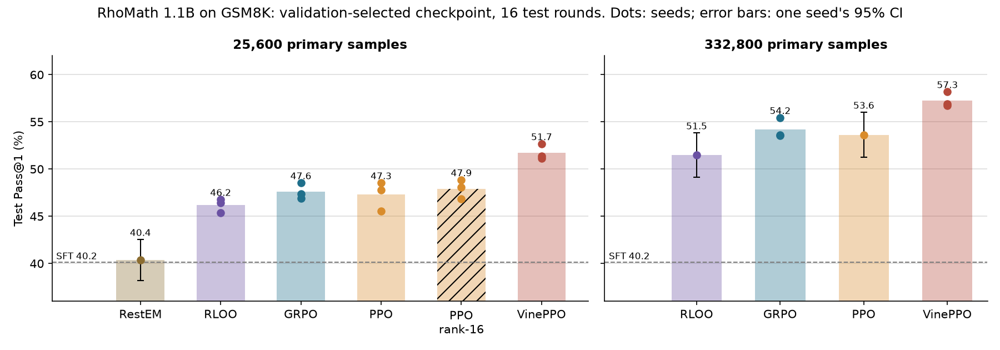
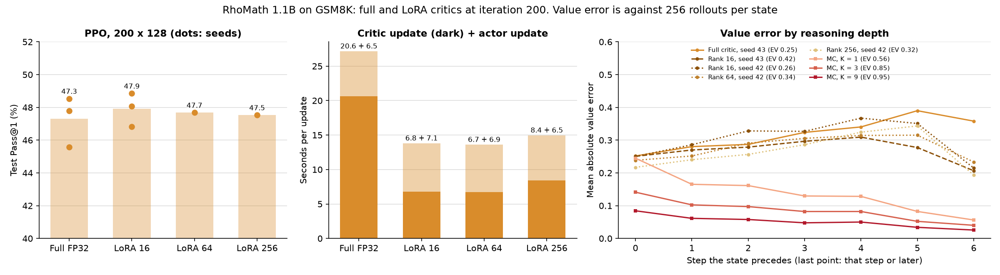
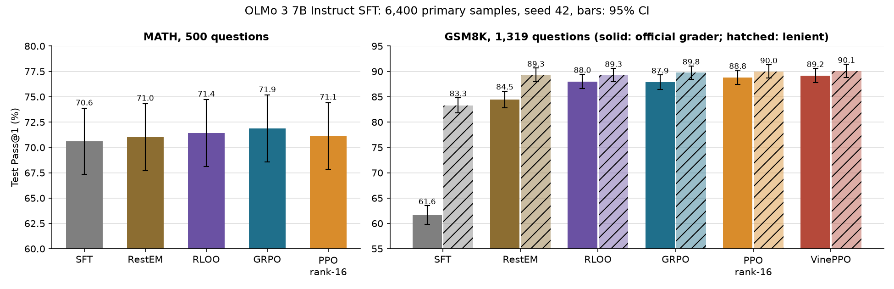
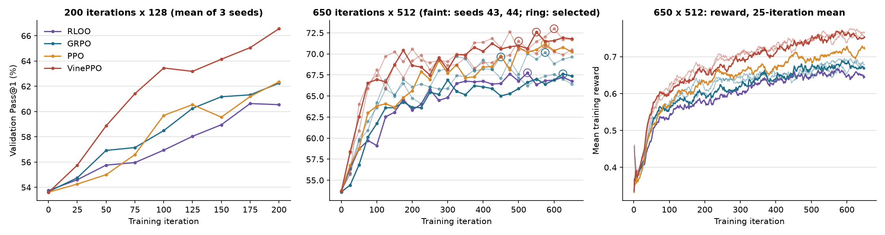
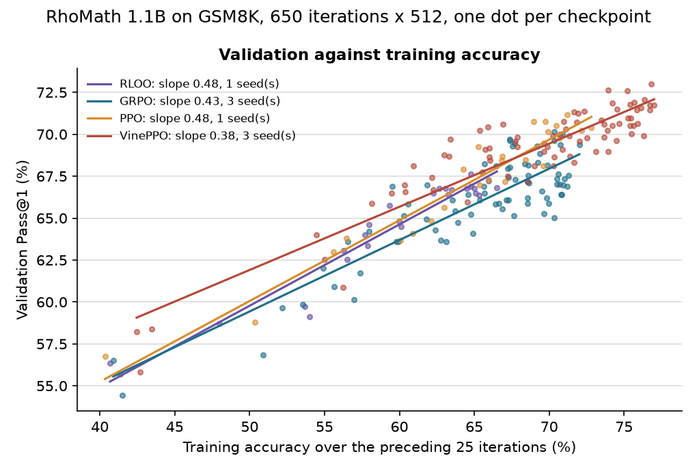
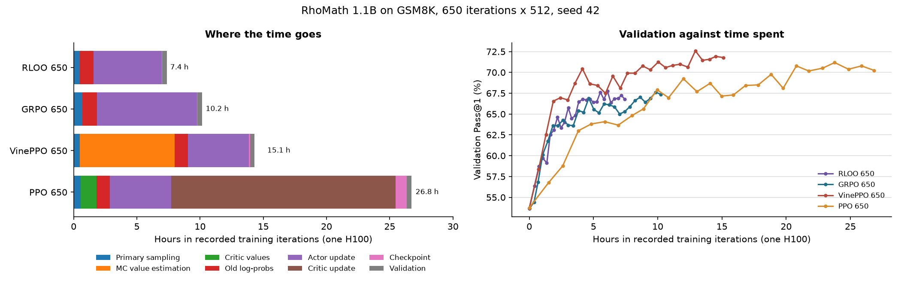

# Results summary 2: seeds at the paper's budget, the LoRA critic, and the value replay

20261126-192403 EST · `4613b20`

Responds to [the submission handoff](../workflow/tasks/agent-tasks/20261124-190704_path-to-submission-handoff.md), item "Refresh the summary". It follows [the results summary of November 24](20261124-174645_results-summary.md), which is unchanged and still holds the ablations, the HF-against-vLLM benchmark and the implementation table. The OLMo arms and the critic-rank sweep were first reported in [the OLMo and LoRA-critic report](20261125-194309_olmo-baseline-set-and-lora-critic.md). New here: three seeds at the paper's budget, the value-estimate replay, the train-against-validation check and two new figures.

Every number below is a cell of [`tables.md`](../../artifacts/training/pace_ice/results-summary-20261126/tables.md), printed from `results.json` in the same directory, unless a sentence names another source.

## Main findings

1. **VinePPO stays the best arm on RhoMath GSM8K with three seeds at the paper's budget.** It scores 57.27 ± 0.80% test Pass@1 against 54.21 ± 1.07% for GRPO. The same-seed gaps are +3.27, +1.28 and +4.62 points. Three seeds do not pin the size: the t interval over seeds is −1.12 to +7.24.
2. **The LoRA critic makes PPO cheaper and leaves its accuracy where it was.** Rank 16 scores 47.91 ± 1.02% against 47.30 ± 1.54% for the full critic (three seeds, 200 × 128). The critic update takes 6.7–6.8 s instead of 19.2–21.9 s.
3. **The replay explains why: no PPO critic here is accurate, whatever its size.** Against 256 rollouts per state, the critics reach an explained variance of 0.25–0.42. One rollout reaches 0.56–0.61 and nine rollouts, VinePPO's setting, 0.95–0.96.
4. **Critic error grows along the reasoning chain and MC error shrinks,** as in the paper's Figure 8a.
5. **On OLMo 3 GSM8K, VinePPO and PPO tie.** VinePPO scores 89.18% and PPO with a rank-16 critic 88.83%; the paired gap is +0.35 [−0.17, +0.88]. VinePPO spent 3.97 hours in training iterations and PPO 1.66.
6. **GSM8K validation is not a proxy for test.** RhoMath SFT scores 53.69% on the validation split and 59.12% on 373 training questions, against 40.15% on test.

OLMo MATH VinePPO is running. See [In progress](#in-progress-and-not-done).

## Reading the numbers

- **Pass@1, checkpoint choice and intervals** are as in the earlier summary: 16 test rounds at temperature 0.35, the validation-best checkpoint, 95% intervals clustered by question, and paired differences in points.
- **± is the sample SD over training seeds.** A "t interval" is over the three seeds (two degrees of freedom).
- **Hours** sum the logged iteration times. They exclude job startup and the final test.

## RhoMath 1.1B on GSM8K

*Figure 1. Bars are seed means and dots are seeds. An arm with one seed shows its 95% interval. Hatched: PPO with a rank-16 LoRA critic. The dashed line is SFT.*

RLOO clips 29–49% of sequence ratios and its gradient norm before clipping is 15–17 against a limit of 1.0 on RhoMath, so it is probably under-tuned and its scores are a lower bound for the method.

### 332,800 primary samples (650 iterations × 512, the paper's budget)

| Arm | Seeds | Test Pass@1 | By seed (42, 43, 44) | Selected iteration | VinePPO minus arm, same seed | Paper, Figure 4 |
|---|---|---|---|---|---|---|
| RLOO | 1 | 51.48% [49.14, 53.82] | 51.48 | 525 | +5.42 [+3.69, +7.16] | 44.5% |
| GRPO | 3 | 54.21 ± 1.07% | 53.63, 55.44, 53.56 | 625, 575, 450 | +3.27 [+1.60, +4.94]; +1.28 [−0.52, +3.08]; +4.62 [+2.81, +6.44] | 44.6% |
| PPO, full critic | 1 | 53.62% [51.23, 56.00] | 53.62 | 575 | +3.28 [+1.54, +5.03] | 50.1% |
| VinePPO | 3 | 57.27 ± 0.80% | 56.90, 56.72, 58.18 | 550, 500, 600 | | 53.4% |

RLOO clips 29–49% of sequence ratios and its gradient norm before clipping is 15–17 against a limit of 1.0 on RhoMath, so it is probably under-tuned and its scores are a lower bound for the method.

- **VinePPO against GRPO:** mean same-seed gap +3.06 points, t interval over seeds −1.12 to +7.24. Two of the three per-seed intervals exclude zero; seed 43's does not.
- **PPO against GRPO:** −0.01 [−1.57, +1.54] at seed 42. GRPO's three-seed mean (54.21%) is above PPO's one seed (53.62%). The paper's 5.5-point PPO lead does not appear.
- **Seeds 43 and 44 ran newer code** (`5be0b27`) than seed 42 (`6212e45` for VinePPO). The change that touches GSM8K is the forward rounding of step cuts. Seed 42 required exact cuts and never failed, so its boundaries would be the same under the new code (inference).

| Arm | Seed | Hours | Primary tokens | MC tokens | Largest phase |
|---|---|---|---|---|---|
| RLOO | 42 | 7.44 | 34.87M | | Actor update, 72.8% |
| GRPO | 42, 43, 44 | 10.25, 10.28, 10.21 | 40.73M, 41.38M, 39.19M | | Actor update, 76.9–77.6% |
| PPO, full critic | 42 | 26.85 | 36.86M | | Critic update, 66.1% |
| VinePPO | 42, 43, 44 | 15.11, 15.85, 16.33 | 38.74M, 39.25M, 40.25M | 629.4M, 635.7M, 667.1M | MC estimation, 49.2–50.4% |

RLOO clips 29–49% of sequence ratios and its gradient norm before clipping is 15–17 against a limit of 1.0 on RhoMath, so it is probably under-tuned and its scores are a lower bound for the method.

- **Time to PPO's best validation score** (71.18% at 23.8 hours, seed 42): VinePPO first exceeds it at 10.0, 12.4 and 9.5 hours for seeds 42, 43 and 44, at iterations 425, 500 and 375. No GRPO or RLOO run reaches it. Read from `results.json`; PPO has one seed.
- **VinePPO seed 42 has 649 of 650 metric rows,** so its hours and tokens are lower bounds.

### 25,600 primary samples (200 iterations × 128, three seeds)

| Arm | Test Pass@1 | By seed (42, 43, 44) | VinePPO minus arm: mean, t interval | Hours per run |
|---|---|---|---|---|
| SFT | 40.15% [38.05, 42.26] | | +11.57 [+9.52, +13.63] | |
| RestEM, matched (seed 42) | 40.37% [38.22, 42.53] | | | |
| RLOO | 46.21 ± 0.72% | 46.46, 46.77, 45.40 | +5.52 [+1.75, +9.28] | 0.64–0.66 |
| GRPO | 47.60 ± 0.85% | 47.37, 48.53, 46.89 | +4.13 [+0.42, +7.84] | 0.67–0.72 |
| PPO, full critic | 47.30 ± 1.54% | 45.57, 48.53, 47.80 | +4.43 [+0.97, +7.89] | 2.33–2.47 |
| PPO, rank-16 critic | 47.91 ± 1.02% | 48.85, 46.82, 48.06 | +3.82 [+0.48, +7.15] | 1.13 |
| VinePPO | 51.73 ± 0.83% | 51.11, 51.40, 52.67 | | 1.37–1.42 |

RLOO clips 29–49% of sequence ratios and its gradient norm before clipping is 15–17 against a limit of 1.0 on RhoMath, so it is probably under-tuned and its scores are a lower bound for the method.

- **Every arm but the rank-16 row is unchanged** from the earlier summary.
- **VinePPO beats rank-16 PPO in each seed:** +2.26, +4.58 and +4.61 points, each interval excluding zero.

## The LoRA critic

*Figure 2. Left: test Pass@1; dots are seeds. Middle: mean seconds per update in the critic update (dark) and the actor update. Right: mean absolute value error by the step a state precedes; the MC lines come from the full-critic replay.*

The LoRA critic keeps PPO's separate value network but freezes its backbone in BF16 and trains all-linear adapters and the value head in FP32. The full critic trains the whole backbone in FP32.

| Critic | Seed | Selected | Validation | Test | Value loss, mean / last 25 | s per update | Critic update, s | Actor update, s |
|---|---|---|---|---|---|---|---|---|
| Full FP32 | 42 | 200 | 61.13% | 45.57% | 0.097 / 0.085 | 42.1 | 19.2 | 6.3 |
| Full FP32 | 43 | 200 | 64.75% | 48.53% | 0.096 / 0.079 | 42.2 | 20.8 | 6.3 |
| Full FP32 | 44 | 175 | 61.19% | 47.80% | 0.095 / 0.081 | 44.7 | 21.9 | 7.0 |
| LoRA 16 | 42 | 175 | 63.00% | 48.85% | 0.141 / 0.091 | 20.3 | 6.7 | 7.0 |
| LoRA 16 | 43 | 200 | 62.27% | 46.82% | 0.133 / 0.093 | 20.3 | 6.8 | 7.0 |
| LoRA 16 | 44 | 175 | 61.86% | 48.06% | 0.137 / 0.094 | 20.3 | 6.8 | 7.1 |
| LoRA 64 | 42 | 200 | 62.53% | 47.68% | 0.117 / 0.089 | 20.2 | 6.7 | 6.9 |
| LoRA 256 | 42 | 125 | 60.52% | 47.53% | 0.102 / 0.081 | 21.9 | 8.4 | 6.5 |

- **Accuracy:** rank 16 minus full is +3.28, −1.71 and +0.27 points at seeds 42, 43 and 44. The mean is +0.61 with a t interval of −5.63 to +6.85. The effect is not distinguishable from zero, and three seeds cannot exclude a few points either way.
- **Time:** the critic update is about three times faster at ranks 16 and 64. The whole-update figure overstates the saving: 20.8–24.5% of the full-critic runs' time is checkpoint work on the 12.4 GB critic file, against under 1% with rank 16.
- **Storage:** a rank-16 checkpoint is 0.304 GB against 12.566 GB ([earlier report](20261125-194309_olmo-baseline-set-and-lora-critic.md#rhomath-ppo-critic-ranks)).
- **More rank fits the training returns better and scores no higher.** Mean value loss falls from 0.141 at rank 16 to 0.102 at rank 256 and 0.097 for the full critic. Test Pass@1 at seed 42 is 48.85%, 47.68% and 47.53% for ranks 16, 64 and 256.

## Value-estimate replay

**Method.** Each replay restores one PPO run at iteration 200: the actor and its critic. The actor samples 8 responses for each of 64 training questions. Every distinct step prefix of those 512 responses gets 256 fresh continuations, and their mean reward is the state's reference value. The critic's value at the same state is compared with it. An MC estimate with K rollouts is scored against the state's other rollouts, so the two share no sample. The reference's own standard error averages 0.012–0.013.

| Checkpoint | States | Mean value | Critic MAE | Critic EV | Critic bias | MC K = 1: MAE, EV | MC K = 3: MAE, EV | MC K = 9: MAE, EV |
|---|---|---|---|---|---|---|---|---|
| Full critic, seed 43 | 1,198 | 0.533 | 0.301 | 0.25 | −0.013 | 0.152, 0.56 | 0.094, 0.85 | 0.056, 0.95 |
| Rank 16, seed 43 | 1,133 | 0.519 | 0.279 | 0.42 | −0.078 | 0.148, 0.57 | 0.091, 0.86 | 0.055, 0.95 |
| Rank 16, seed 42 | 1,266 | 0.404 | 0.312 | 0.26 | +0.098 | 0.135, 0.61 | 0.083, 0.87 | 0.051, 0.96 |
| Rank 64, seed 42 | 1,319 | 0.403 | 0.280 | 0.34 | −0.076 | 0.139, 0.59 | 0.086, 0.86 | 0.052, 0.95 |
| Rank 256, seed 42 | 1,327 | 0.422 | 0.264 | 0.32 | +0.005 | 0.138, 0.60 | 0.084, 0.87 | 0.052, 0.95 |

MAE is mean absolute error. EV is explained variance, 1 − Var(reference − estimate) / Var(reference).

Mean absolute error by the step the state precedes (number of states in brackets; step 0 is the bare question):

| Estimator | 0 | 1 | 2 | 3 | 4 | 5 | 6+ |
|---|---|---|---|---|---|---|---|
| Full critic, seed 43 | 0.252 (64) | 0.280 (386) | 0.287 (333) | 0.324 (226) | 0.340 (105) | 0.390 (55) | 0.358 (29) |
| Rank 16, seed 43 | 0.251 (64) | 0.270 (398) | 0.279 (324) | 0.296 (215) | 0.309 (84) | 0.277 (34) | 0.207 (14) |
| Rank 16, seed 42 | 0.250 (64) | 0.286 (389) | 0.328 (360) | 0.327 (234) | 0.367 (124) | 0.351 (56) | 0.215 (39) |
| Rank 64, seed 42 | 0.238 (64) | 0.252 (414) | 0.291 (372) | 0.305 (242) | 0.314 (128) | 0.315 (62) | 0.233 (37) |
| Rank 256, seed 42 | 0.217 (64) | 0.240 (406) | 0.256 (377) | 0.286 (251) | 0.324 (124) | 0.343 (68) | 0.193 (37) |
| MC, K = 1, mean of the five replays | 0.241 | 0.172 | 0.143 | 0.121 | 0.090 | 0.057 | 0.035 |
| MC, K = 3 | 0.144 | 0.106 | 0.088 | 0.075 | 0.057 | 0.037 | 0.026 |
| MC, K = 9 | 0.086 | 0.063 | 0.054 | 0.045 | 0.035 | 0.024 | 0.016 |

- **Every critic is less accurate than one rollout** past the bare question. Critic MAE is 0.264–0.312 overall; one rollout gives 0.135–0.152 and nine give 0.051–0.056.
- **The LoRA critics are no worse than the full critic.** At seed 43, on the same 64 questions, rank 16 has MAE 0.279 and EV 0.42 against 0.301 and 0.25 for the full critic.
- **The differences between critics are within the spread between seeds.** Rank 16 has EV 0.42 at seed 43 and 0.26 at seed 42. The replay has no intervals; states cluster within 64 questions.
- **Depth:** critic error rises from 0.22–0.25 at the question to 0.28–0.39 before steps 3–5. MC error falls at every step. The dip at 6+ rests on 14–39 states.
- **Against the paper:** it reports critic explained variance of 0.7–0.9 (Figure D.5). Ours is 0.25–0.42 after 25,600 training samples. The critics of the 650-iteration PPO run were not replayed.
- **Scope:** one checkpoint per run, the last one. The tested checkpoint is earlier for rank 16 at seed 42 (iteration 175) and for rank 256 (iteration 125). The questions are training questions. The full critic was replayed at seed 43 only, because that critic file was still on scratch.

## OLMo 3 7B Instruct SFT

*Figure 3. 50 iterations × 128 samples (RestEM: 10 rounds × 640), seed 42, H200. GSM8K shows the official grader (solid) and the lenient reading (hatched). MATH VinePPO is not finished.*

RLOO clips 29–49% of sequence ratios and its gradient norm before clipping is 15–17 against a limit of 1.0 on RhoMath, so it is probably under-tuned and its scores are a lower bound for the method.

| Arm | GSM8K, official grader | Gain over SFT | GSM8K, lenient | GSM8K hours | MATH | Gain over SFT | MATH hours |
|---|---|---|---|---|---|---|---|
| SFT | 61.65% [59.80, 63.50] | | 83.29% [81.78, 84.80] | | 70.59% [67.32, 73.85] | | |
| RestEM, matched | 84.49% [82.85, 86.12] | +22.84 [+21.31, +24.37] | 89.31% [87.96, 90.65] | 3.67 | 71.00% [67.69, 74.31] | +0.41 [−0.31, +1.14] | 4.47 |
| RLOO | 88.01% [86.59, 89.43] | +26.36 [+24.74, +27.98] | 89.26% [87.93, 90.59] | 1.07 | 71.41% [68.11, 74.72] | +0.83 [−0.04, +1.69] | 2.31 |
| GRPO | 87.87% [86.45, 89.30] | +26.23 [+24.61, +27.84] | 89.77% [88.47, 91.07] | 1.08 | 71.86% [68.57, 75.16] | +1.27 [+0.38, +2.17] | 2.46 |
| PPO, rank-16 critic | 88.83% [87.44, 90.21] | +27.18 [+25.52, +28.83] | 90.01% [88.72, 91.31] | 1.66 | 71.12% [67.83, 74.42] | +0.54 [−0.20, +1.28] | 3.25 |
| VinePPO | 89.18% [87.78, 90.58] | +27.53 [+25.85, +29.21] | 90.08% [88.76, 91.40] | 3.97 | running | | |

RLOO clips 29–49% of sequence ratios and its gradient norm before clipping is 15–17 against a limit of 1.0 on RhoMath, so it is probably under-tuned and its scores are a lower bound for the method.

- **GSM8K, official grader, paired:** VinePPO minus PPO +0.35 [−0.17, +0.88]; VinePPO minus GRPO +1.30 [+0.60, +2.01]; VinePPO minus RLOO +1.17 [+0.55, +1.79]; PPO minus GRPO +0.95 [+0.36, +1.55].
- **On the lenient reading the five trained arms span 89.26–90.08%.** The official-grader gaps between arms are therefore partly answer format. The earlier report gives VinePPO minus PPO on the lenient reading as +0.07 [−0.43, +0.56].
- **Cost on GSM8K:** VinePPO sampled 74.7M MC tokens, 77 per primary token, and MC estimation is 73.5% of its time. RhoMath VinePPO samples 16–20 MC tokens per primary token.
- **MATH:** GRPO remains the only arm whose gain over SFT excludes zero. PPO minus GRPO is −0.74 [−1.57, +0.09].
- **One seed each.** The OLMo PPO arms use the rank-16 critic; no full-critic OLMo PPO exists.

## Validation, training and test on GSM8K

Both SFT models were scored with the validation protocol (four rounds, 373 questions) on the validation split and on 373 random training questions.

| Model | Reading | Validation split | 373 training questions | Test split, 16 rounds |
|---|---|---|---|---|
| RhoMath SFT | official | 53.69% [49.44, 57.93] | 59.12% [54.98, 63.25] | 40.15% [38.05, 42.26] |
| OLMo 3 SFT | official | 68.77% [65.17, 72.36] | 63.34% [59.66, 67.02] | 61.65% [59.80, 63.50] |
| OLMo 3 SFT | lenient | 90.42% [88.10, 92.73] | 86.06% [83.27, 88.85] | 83.29% [81.78, 84.80] |

- **RhoMath:** validation is 13.5 points above test and 5.4 below the training questions. It behaves like training data, not like test data.
- **OLMo:** the training questions score close to test (63.34% against 61.65%), and validation is 5.4 points above them. So the validation questions are also somewhat easier in themselves (inference from one model).
- **The three sets hold different questions,** so these comparisons are unpaired. The validation and training intervals overlap for both models.
- **The cause is not established.** The 373 validation questions come from the original GSM8K training split, and no validation or test question is in the 7,100-question training split (job 7298316). Whether RhoMath's SFT stage saw the validation questions is not something I checked.
- **Consequence:** validation Pass@1 ranks checkpoints within a run. It does not estimate test Pass@1, and a validation curve overstates test accuracy by 13 points or more on RhoMath.

## Training curves and generalization

*Figure 4. Left: validation Pass@1, mean of three seeds. Middle: the long runs; faint lines are seeds 43 and 44 and rings mark the selected checkpoints. Right: mean training reward, smoothed over 25 iterations.*

RLOO clips 29–49% of sequence ratios and its gradient norm before clipping is 15–17 against a limit of 1.0 on RhoMath, so it is probably under-tuned and its scores are a lower bound for the method.

- **Reward over the last 25 iterations of the long runs:** VinePPO 0.753, 0.754 and 0.767; PPO 0.721; GRPO 0.668, 0.666 and 0.679; RLOO 0.644.
- **Best validation score:** VinePPO 72.59%, 71.51% and 72.99%; PPO 71.18%; GRPO 67.63%, 70.17% and 69.64%; RLOO 67.76%.

*Figure 5. The long runs. Each dot is a checkpoint: validation Pass@1 against the mean correctness of the training responses over the 25 iterations before it. Lines are least-squares fits per arm.*

RLOO clips 29–49% of sequence ratios and its gradient norm before clipping is 15–17 against a limit of 1.0 on RhoMath, so it is probably under-tuned and its scores are a lower bound for the method.

- **The paper's Figure 5 claim is that VinePPO turns training accuracy into more test accuracy.** Here VinePPO's fitted slope (0.38) is not steeper than the others (0.43–0.48). Its line lies above GRPO's across their shared range, and it reaches higher training accuracy than any other arm.
- **This figure uses validation, not test,** and validation behaves like training data on RhoMath (previous section). It is weak evidence on the paper's claim either way.

*Figure 6. The long RhoMath runs at seed 42, unchanged in content from the earlier summary's Figure 4.*

RLOO clips 29–49% of sequence ratios and its gradient norm before clipping is 15–17 against a limit of 1.0 on RhoMath, so it is probably under-tuned and its scores are a lower bound for the method.

## In progress and not done

State at 19:24 on November 26.

| Work | State |
|---|---|
| OLMo MATH VinePPO, 50 iterations (job 7360491, successor 7361315, root `handoff-olmo3-math-vineppo-50-s42-30`) | Running since 15:55. Three iterations logged: 1,810 s, 5,072 s and 2,272 s. No splitter rejections. At the mean of 3,051 s the 50 iterations need about 42 hours, so three 16-hour allocations and a finish on November 28 or 29 (estimate) |
| Full fine-tuning control for GRPO | Not run. It was allowed only on idle GPUs, and our jobs were queued throughout |
| RhoMath on MATH; adaptive MC budget; prefix-caching experiment | Not started, by Tom's decisions |
| PPO at 650 × 512 with a LoRA critic; more OLMo seeds | Not planned |

- **Why MATH VinePPO is slow:** it samples 124–153 MC tokens per primary token, and in two of the three iterations the MC phase spends more time outside generation than in it (MC phase 1,639 s, 4,964 s and 2,142 s; generation 929 s, 1,414 s and 980 s). Read from the run's `metrics.jsonl`. The remainder is probably answer grading, which runs a subprocess per distinct MATH answer (inference).
- **To stop it:** `scancel 7360491 7361315`. The run resumes from its last checkpoint if relaunched.

## Caveats

- **Seeds are replicates, not controls.** vLLM sampling differs between identical runs.
- **Three seeds give wide t intervals.** PPO and RLOO at the paper's budget, and every OLMo arm, have one seed.
- **The LoRA critic differs from the full critic in two ways at once:** trainable parameters and backbone precision (BF16 against FP32). The critic learning rate (1e-5) was not retuned for it.
- **Code versions differ across arms.** The full-critic and rank-16 PPO runs were made at different commits (`6212e45` and `95de38c` at seeds 43 and 42). PPO full-critic seeds 43 and 44 each lack one metric row.
- **The MATH splitter now departs from upstream:** placeholders are restored in reverse insertion order, and a response the splitter still rejects trains as one step and is counted. No finished run used it. All 512 stored OLMo MATH responses segment under it (7 failed before).

## Sources

- **Data and figures:** `artifacts/training/pace_ice/results-summary-20261126/`. `results.json` holds the 38 runs, the paired differences, the five replay summaries and the SFT check (job 7366315; rerun 7366467 after a refactor gave an identical file).
- **Scripts:** `scripts/figures/collect_results_summary.py`, `plot_results_summary.py` and `print_results_tables.py`; `scripts/diagnostics/value_estimate_replay.py` and `value_estimate_analysis.py`; `scripts/diagnostics/train_subset_as_validation.py` and `evaluate_model_baseline.py`.
- **Replay jobs:** 7360492–7360496, on H100, at `49bda9e`. Each drew 18.1–25.8M continuation tokens in 22–25 minutes.
- **SFT check jobs:** 7360497–7360500.
- **Bucket:** the four seed runs were verified by jobs 7326918, 7326919, 7317397 and 7317398. The five replay and four SFT-check directories were uploaded and verified by job 7366410 (9 and 14 files each).
- **Paper values:** Figure 4, Figure 5, Figure 8 and Figure D.5 of [the paper notes](../knowledge-bases/papers/vineppo.md).
- **W&B links** for every run are in `results.json` under `wandb`.
