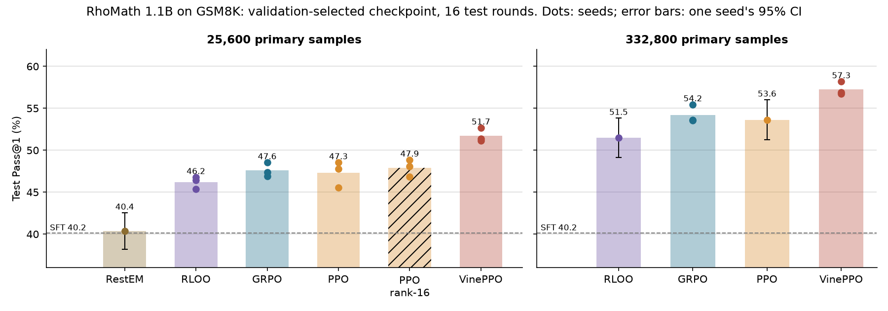
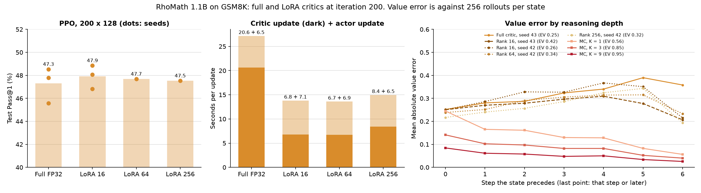

# Draft: final report for the December 7 submission

20261126-192724 EST · `4613b20`

Responds to [the submission handoff](../workflow/tasks/agent-tasks/20261124-190704_path-to-submission-handoff.md), item "Report draft". It is a draft for Tom to edit into the PDF. The sections are the ones [the course page](../knowledge-bases/course-instructions/cs8803-drl-f26__project_html.md) lists. Every number is from [results summary 2](20261126-192403_results-summary-seeds-critic-replay.md) and its [`tables.md`](../../artifacts/training/pace_ice/results-summary-20261126/tables.md), except the paper's own figures. One result is still open: OLMo MATH VinePPO is running and its cells say so.

---

# VinePPO on one GPU: a reproduction, and a LoRA critic for PPO

Code: <https://github.com/tomohiro-sawada/cs8803-drl-f26_vineppo> (branch and commit to be fixed at submission)

## 1. Introduction and background

**The paper.** VinePPO (Kazemnejad et al., arXiv:2410.01679) studies credit assignment when a language model is trained with reinforcement learning on math problems. The model writes a solution in steps and receives one reward at the end: 1 if the final answer is right. PPO needs the value of each intermediate state to decide which step helped. The usual source is a value network, a second model trained to predict the final reward.

The paper's argument has two parts:

- **Value networks are poor at this task.** Their predictions are close to chance at ranking next steps, and they get worse later in the solution.
- **A language environment can be reset to any prefix.** So the value of a partial solution can be estimated directly: sample K = 9 completions from it and average their rewards. The advantage of a step is the estimated value after it minus the value before it.

VinePPO is PPO with this Monte Carlo (MC) estimate in place of the value network. The paper reports that it beats PPO, GRPO, RLOO and RestEM on GSM8K and MATH, and reaches PPO's best accuracy in less wall-clock time even though each iteration is slower.

**Our reproduction.** We reimplemented VinePPO, PPO, GRPO, RLOO and RestEM in one trainer that runs on a single GPU, and trained the paper's smaller model, RhoMath 1.1B, on GSM8K:

- at the paper's budget of 650 iterations × 512 responses, with three seeds for VinePPO and GRPO and one for PPO and RLOO;
- at a smaller budget of 200 × 128, with three seeds for every method.

We also ran the methods on a model the paper does not use, OLMo 3 7B Instruct SFT, on GSM8K and MATH.

**What we found.**

- VinePPO is the best method on RhoMath GSM8K at both budgets, and its lead over PPO matches the paper's (+3.28 points against 3.3).
- Its lead over GRPO is about a third of the paper's, and PPO does not beat GRPO.
- Our modification, a LoRA critic for PPO, cuts the critic update to a third of its time and leaves PPO's accuracy unchanged. A direct measurement of critic accuracy shows why: the critic was never limited by its size.

## 2. Modification: a LoRA critic for PPO

**Motivation.** In our reproduction the value network is what makes PPO expensive. It is a second full copy of the model, trained in FP32:

- The critic update takes 66.1% of PPO's training time at the paper's budget. PPO needs 26.85 hours where VinePPO needs 15.1–16.3.
- Each critic checkpoint is 12.4 GB.

So PPO pays the most for the component the paper says is unreliable. We asked whether that cost buys anything.

**The modification.** The critic keeps its own backbone, initialized from the same pretrained weights, but the backbone is frozen in BF16. Only low-rank adapters (LoRA) on every linear layer and the scalar value head are trained, in FP32. Alpha is twice the rank. The value loss, the targets, the clipping and the critic learning rate are those of the full critic.

**Questions.**

1. Does PPO lose accuracy with the smaller critic?
2. Is the smaller critic a worse value estimator, measured against ground truth?
3. Does either critic come close to the MC estimates VinePPO uses?

If the full critic's accuracy came from its capacity, the LoRA critic should do worse on questions 1 and 2.

**Procedure.** We swept ranks 16, 64 and 256 at one seed, chose the rank with the best validation score (rank 16), ran two more seeds at that rank, and used it for PPO on OLMo 3.

## 3. Experimental setup

**Models and data.**

| | RhoMath 1.1B | OLMo 3 7B Instruct SFT |
|---|---|---|
| Starting point | The paper's GSM8K SFT checkpoint | `allenai/Olmo-3-7B-Instruct-SFT` |
| Tasks | GSM8K | GSM8K and MATH |
| Budget | 650 × 512 and 200 × 128 responses | 50 × 128 responses |
| GPU | One H100 | One H200 |

GSM8K uses the paper's split: 7,100 training, 373 validation and 1,319 test questions. MATH is evaluated on 500 test questions.

**Training.** Each iteration samples 8 responses per question. PPO and VinePPO use a clip of 0.2 and a KL coefficient of 1e-4; GRPO and RLOO use 3e-3. VinePPO draws K = 9 MC completions per step boundary. PPO's critic uses γ = 1, λ = 1 and value clipping at 0.2.

**Evaluation.** Checkpoints are saved every 25 iterations (10 on OLMo). The one with the best validation Pass@1 is tested once: one sampled answer per test question at temperature 0.35, averaged over 16 rounds. Intervals are 95% and clustered by question. Differences between methods are paired on the same questions. With three seeds we also give a t interval over seeds.

**Value-estimate replay.** To measure critic accuracy we restore a PPO run at iteration 200, sample 8 responses for each of 64 training questions, and draw 256 completions from every distinct step prefix (1,133–1,327 states per run). The mean reward of the 256 is the reference value. We compare it with the critic's prediction at the same state and with MC estimates from K = 1, 3 and 9 of the completions, scored against the remaining ones. This follows Section 7 of the paper. We report mean absolute error (MAE) and explained variance.

**Deviations from the paper.**

| Aspect | Paper or its code | Ours | Why |
|---|---|---|---|
| Policy fine-tuning | All parameters | LoRA rank 16, alpha 32, all linear layers; BF16 base, FP32 adapters | Policy, reference and sampler share one GPU |
| Learning rate | 1e-6 | 1e-5; constant at 200 × 128, warmup and decay at 650 × 512 | LoRA setting |
| Training sampling | Temperature 0.6, top-p 0.9 | Temperature 1.0, no truncation of the distribution | The learner's log-probabilities then match the sampler's |
| Truncated responses | No penalty | Reward −1; at most 1,024 new tokens | Not ablated |
| Tokens | Sequences and MC prefixes rebuilt from text | Sampled token IDs kept end to end | Re-encoding can change tokens |
| Step boundaries | Text splitter | Same splitter; a cut inside a token moves to the next token boundary; coincident cuts merge | Boundaries stay on sampled tokens |
| MATH splitter | Rejects some responses | Placeholders restored in reverse order; a response still rejected is one step | Affects only OLMo MATH VinePPO |
| MC prefixes | Identical text sampled once | Identical token prefixes sampled once | Same intent, on tokens |
| PPO and VinePPO loss | Advantages normalized over the batch | Normalized over response tokens once per iteration; token-mean objective; per-token KL term capped at 10 | Implementation details |
| GRPO and RLOO | Not in the paper's code | Our own losses | The paper gives coefficients only |
| RestEM | Whole training set per round | Same number of samples as the RL runs | Matched budget |
| Sampler | A vLLM engine on each GPU of a multi-GPU job | One vLLM replica on the learner's GPU | One GPU |
| Checkpoint choice | | Best validation Pass@1, tested once | |
| Evaluation sampling | Temperature 0.35 | Same, with top-p 0.9 | |
| Scale | RhoMath and DeepSeekMath 7B on GSM8K and MATH | RhoMath on GSM8K only; OLMo 3 instead of DeepSeekMath | Compute |

Two more points: seed 42 of the long runs predates the token-boundary rounding on GSM8K but never needed it, so its boundaries are the same (inference); and OLMo GSM8K is reported under the official grader and under a lenient reading that accepts the right final number in any format.

## 4. Results and discussion

### 4.1 Reproduction

*Figure 1. RhoMath 1.1B on GSM8K. Bars are means over seeds and dots are seeds; a method with one seed shows its 95% interval. Hatched: PPO with the rank-16 LoRA critic.*

RLOO clips 29–49% of sequence ratios and its gradient norm before clipping is 15–17 against a limit of 1.0 on RhoMath, so it is probably under-tuned and its scores are a lower bound for the method.

| Method | Paper | Ours, 650 × 512 | Ours, 200 × 128 (three seeds) |
|---|---|---|---|
| SFT | 40.3% | 40.15% | 40.15% |
| RLOO | 44.5% | 51.48% (one seed) | 46.21 ± 0.72% |
| GRPO | 44.6% | 54.21 ± 1.07% (three seeds) | 47.60 ± 0.85% |
| PPO, full critic | 50.1% | 53.62% (one seed) | 47.30 ± 1.54% |
| PPO, rank-16 LoRA critic | | | 47.91 ± 1.02% |
| VinePPO | 53.4% | 57.27 ± 0.80% (three seeds) | 51.73 ± 0.83% |

RLOO clips 29–49% of sequence ratios and its gradient norm before clipping is 15–17 against a limit of 1.0 on RhoMath, so it is probably under-tuned and its scores are a lower bound for the method.

| Claim in the paper | Our result | Verdict |
|---|---|---|
| VinePPO is the best method | Best in every same-seed comparison at both budgets | Replicates |
| VinePPO beats PPO by 3.3 points | +3.28 [+1.54, +5.03] at 650 × 512 (one seed); +4.43 at 200 × 128 (t interval over seeds +0.97 to +7.89) | Replicates |
| VinePPO beats GRPO by 8.8 | +3.27, +1.28 and +4.62 by seed; mean +3.06 (t interval −1.12 to +7.24) | Same sign, about a third of the size |
| VinePPO beats RLOO by 8.9 | +5.42 [+3.69, +7.16], one seed | Same sign, smaller |
| PPO beats GRPO by 5.5 | −0.01 [−1.57, +1.54], one seed | Does not replicate |
| RestEM gains 2.5 over SFT | +0.22 [−0.53, +0.97] at a matched 25,600-sample budget | Not comparable |
| VinePPO reaches PPO's best accuracy in about 3.0× less time and 9× fewer steps | Validation: 9.5–12.4 hours against 23.8, and 375–500 iterations against 575 | Time replicates; steps do not |
| Value networks are inaccurate and get worse along the solution | Critic explained variance 0.25–0.42; error rises with depth (Section 4.2) | Replicates |
| VinePPO generalizes better per unit of training accuracy | Its validation-against-training slope is not steeper (0.38 against 0.43–0.48) | Not supported, on validation data |
| The gap widens on MATH | RhoMath was not run on MATH | Untested |

RLOO clips 29–49% of sequence ratios and its gradient norm before clipping is 15–17 against a limit of 1.0 on RhoMath, so it is probably under-tuned and its scores are a lower bound for the method.

- **What replicates.** The ordering with VinePPO first, the size of its lead over PPO, and the diagnosis of the value network.
- **What does not.** Our GRPO and RLOO are 9.6 and 7.0 points above the paper's, while PPO and VinePPO are 3.5 and 3.9 above. GRPO therefore matches PPO, and VinePPO's lead over the critic-free baselines shrinks.
- **Why the baselines are stronger is not established.** The candidates are our deviations: sampling at temperature 1.0, a LoRA policy at a ten times higher learning rate, the truncation penalty, and our own GRPO and RLOO losses. We did not ablate them.
- **The time result holds for a different reason.** In the paper a VinePPO iteration is up to five times slower than a PPO iteration. In ours it is faster, because the full critic update is two thirds of PPO's time. VinePPO spends half its time on MC estimation (49.2–50.4%) and samples 16–17 MC tokens per trained token.

### 4.2 The LoRA critic

*Figure 2. RhoMath 1.1B on GSM8K, 200 × 128. Left: test Pass@1 of PPO by critic; dots are seeds. Middle: seconds per update in the critic update (dark) and the actor update. Right: mean absolute error of each value estimate against 256 rollouts, by the step the state precedes.*

**Accuracy and cost.**

| | Full FP32 critic | Rank-16 LoRA critic |
|---|---|---|
| Test Pass@1, three seeds | 47.30 ± 1.54% | 47.91 ± 1.02% |
| By seed (42, 43, 44) | 45.57, 48.53, 47.80 | 48.85, 46.82, 48.06 |
| Critic update per iteration | 19.2–21.9 s | 6.7–6.8 s |
| Training time per run | 2.33–2.47 hours | 1.13 hours |
| Critic checkpoint | 12.566 GB | 0.304 GB |

- **PPO's accuracy does not change.** The same-seed differences are +3.28, −1.71 and +0.27 points; the mean is +0.61 with a t interval of −5.63 to +6.85. Three seeds cannot exclude a difference of a few points in either direction.
- **The critic update is three times faster.** The total time halves, but part of that is the full critic's checkpoint traffic (20.8–24.5% of its time), so the critic-update row is the cleaner comparison.
- **Higher ranks did not help:** 47.68% at rank 64 and 47.53% at rank 256, one seed each.
- **PPO still trails VinePPO.** VinePPO beats rank-16 PPO by 3.82 points (t interval +0.48 to +7.15) and in each seed.

**Why it worked as a cost reduction and failed to close the gap.** The replay measures each estimator against 256 rollouts per state.

| Value estimate | Mean absolute error | Explained variance |
|---|---|---|
| Full critic (seed 43) | 0.301 | 0.25 |
| Rank-16 LoRA critic (seeds 43, 42) | 0.279, 0.312 | 0.42, 0.26 |
| Rank-64 and rank-256 LoRA critics (seed 42) | 0.280, 0.264 | 0.34, 0.32 |
| MC, K = 1 | 0.135–0.152 | 0.56–0.61 |
| MC, K = 3 | 0.083–0.094 | 0.85–0.87 |
| MC, K = 9 (VinePPO) | 0.051–0.056 | 0.95–0.96 |

- **The LoRA critic is no worse than the full critic.** On the same 64 questions at seed 43, rank 16 has lower error (0.279 against 0.301) and higher explained variance (0.42 against 0.25). The two rank-16 seeds differ from each other by as much, so we read the critics as equal, not the LoRA critic as better.
- **So capacity was not the limit.** Training a full 1.1B-parameter backbone in FP32 buys no value accuracy over rank-16 adapters on a frozen BF16 backbone. That is why the cheaper critic costs PPO nothing.
- **Both critics are far from the MC estimate.** A single rollout is about twice as accurate as any critic, and nine rollouts about five times. Replacing one inaccurate critic with another equally inaccurate one cannot move PPO toward VinePPO. That is why the modification does not close the gap.
- **The error has the shape the paper describes.** Critic error rises from 0.22–0.25 at the bare question to 0.28–0.39 before steps 3 to 5. MC error falls at every step, from 0.086 to 0.016 for K = 9 (Figure 2, right).
- **A consistent side observation:** PPO with either critic scores the same as GRPO at this budget (47.30% and 47.91% against 47.60%), and GRPO has no learned value at all.
- **More rank fits the training returns better.** Mean value loss falls from 0.141 at rank 16 to 0.102 at rank 256 and 0.097 for the full critic, and test accuracy does not rise with it. The critic probably lacks data, not parameters: it sees 25,600 responses with one terminal reward each (inference; we did not vary the data).

**Limits of this evidence.**

- The replay covers the 200 × 128 runs at their last checkpoint. The paper reports critic explained variance of 0.7–0.9 at its full budget. We did not replay the 650 × 512 PPO critic, so we cannot say whether our critics improve with thirteen times more data.
- The full critic was replayed at one seed. The replay has no confidence intervals; its states cluster within 64 questions.
- The LoRA critic changes two things at once, the trainable parameters and the backbone precision, and its learning rate was not retuned.
- We did not run LoRA-critic PPO at 650 × 512.

### 4.3 Extension: OLMo 3 7B

| Method | GSM8K, official grader | GSM8K, lenient | GSM8K training hours | MATH |
|---|---|---|---|---|
| SFT | 61.65% | 83.29% | | 70.59% |
| RestEM | 84.49% | 89.31% | 3.67 | 71.00% |
| RLOO | 88.01% | 89.26% | 1.07 | 71.41% |
| GRPO | 87.87% | 89.77% | 1.08 | 71.86% |
| PPO, rank-16 LoRA critic | 88.83% | 90.01% | 1.66 | 71.12% |
| VinePPO | 89.18% | 90.08% | 3.97 | running |

RLOO clips 29–49% of sequence ratios and its gradient norm before clipping is 15–17 against a limit of 1.0 on RhoMath, so it is probably under-tuned and its scores are a lower bound for the method.

- **VinePPO and PPO tie on GSM8K:** +0.35 points [−0.17, +0.88] for VinePPO, at 2.4 times the training time. Both beat GRPO and RLOO by about one point under the official grader (VinePPO minus GRPO: +1.30 [+0.60, +2.01]).
- **Most of the GSM8K gain is answer format.** The SFT model often writes a right answer in a form the official grader rejects. Under the lenient reading the five trained methods span 89.26–90.08%.
- **MATH barely moves** in 6,400 training responses. GRPO's +1.27 [+0.38, +2.17] is the only gain over SFT whose interval excludes zero.
- **MC estimation is costlier here:** 77 MC tokens per trained token on GSM8K against 16–17 for RhoMath, and 73.5% of VinePPO's time.
- **One seed each,** so these are weaker than the RhoMath results.

*OLMo MATH VinePPO is expected to finish on November 28 or 29 (estimate). Fill its cell and one sentence from the next results summary.*

### 4.4 Conclusion

VinePPO's central result reproduces on one GPU with a LoRA policy: it is the best method, and it beats PPO by the margin the paper reports. Its lead over critic-free baselines is smaller here. A PPO critic can be made three times cheaper with LoRA at no measurable loss, but the measurement that explains this also explains why PPO stays behind: at this data scale the critic's predictions carry less information about a state's value than a single rollout.

## 5. Video link

*Placeholder: link to the final presentation video.*

---

## Notes for Tom (not part of the report)

- **Length.** The course asks for about 2–4 pages. This draft is longer. The deviation table and Section 4.3 are the natural candidates to shorten or move to an appendix.
- **Figures used:** `rhomath-gsm8k-test.png` and `rhomath-lora-critic.png` in `artifacts/training/pace_ice/results-summary-20261126/`. The same directory has the curves, cost, generalization and OLMo figures.
- **RLOO footnote:** it stands under every table and figure that shows RLOO, with your text.
- **Open cell:** OLMo MATH VinePPO (job 7360491).
- **Claims I could not support and left out:** any reason for the stronger GRPO and RLOO; any statement about RhoMath on MATH; whether LoRA for the policy costs accuracy (the full fine-tuning control was not run).
- **Wording to check:** "the paper's GSM8K SFT checkpoint" for RhoMath, and the paper-code column of the deviation table. I took it from the earlier reports' tables and checked only the advantage-normalization and sampler rows against the paper notes.
